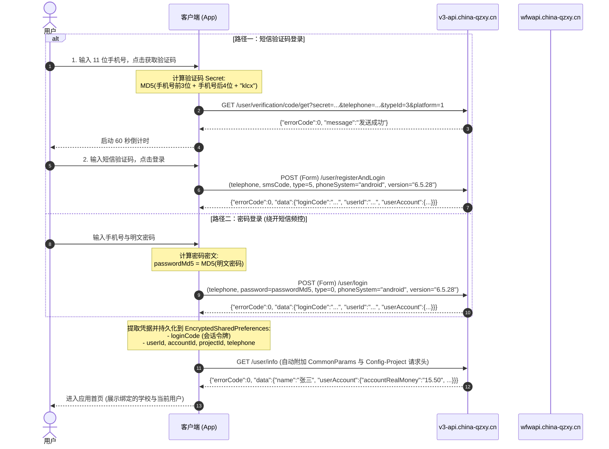
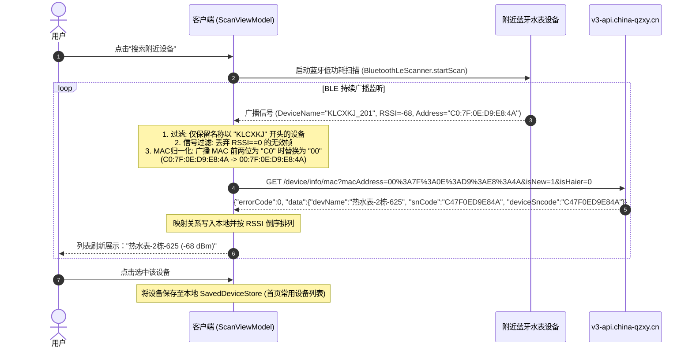
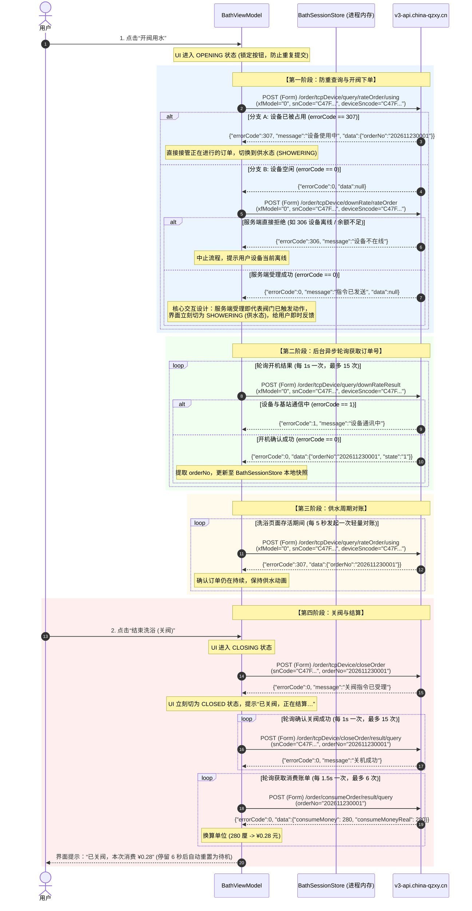
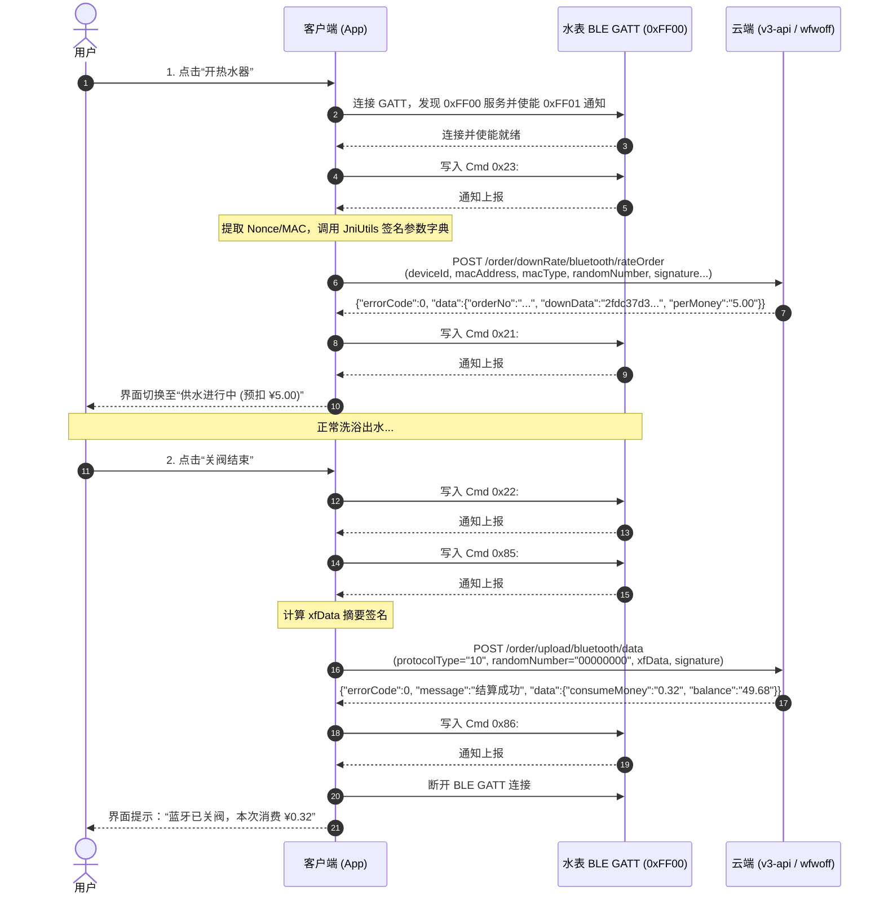
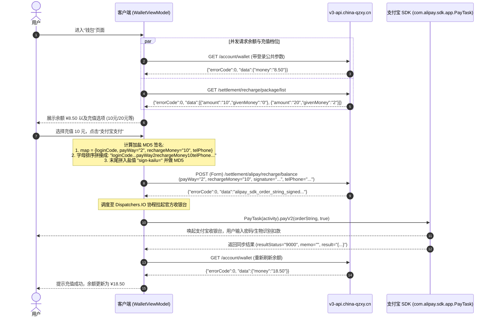
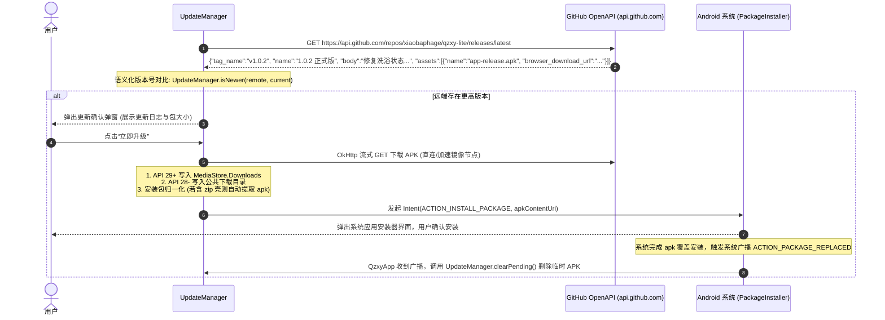

# 02_业务调用时序图

本文档详细记录了 `qzxy-lite` 客户端中关键业务链路的 API 调用时序图（Mermaid 格式），涵盖认证、设备扫描、洗浴控制、钱包充值和自更新流程。

---

## 1. 认证与登录时序 (短信验证码 / 密码登录)

客户端提供两条登录路径：
1. **短信验证码登录**：通过 `user/verification/code/get` 获取验证码，利用 `user/registerAndLogin` 完成登录并下发全套会话 ID。
2. **密码登录**：通过 `user/login` 发送手机号及密码 MD5，绕开短信每日频控限制。

---

## 2. 蓝牙设备发现与云端识别时序

用户进入设备扫描页时，手机执行 BLE 广播捕获，过滤特定前缀并归一化 MAC，再向服务端置换设备真实元数据。

---

## 3. 核心洗浴业务全生命周期时序

该时序包含完整的 7 个阶段：**防重复检查 $\rightarrow$ 开阀下单 $\rightarrow$ 异步开机轮询 $\rightarrow$ 周期心跳对账 $\rightarrow$ 关阀下单 $\rightarrow$ 异步关阀轮询 $\rightarrow$ 消费账单结算**。

---

## 3.1 蓝牙脱机水表（高校无网设备）中继开阀与回传时序

当水表未联网、TCP 开阀返回 `306 设备不在线`，或用户开启“蓝牙脱机模式”时，客户端通过蓝牙桥接完成开阀与扣款：

---

## 4. 钱包查询与支付宝充值下单时序

---

## 5. 应用自更新时序 (基于 GitHub Release)

